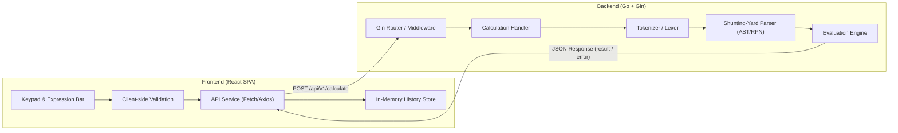
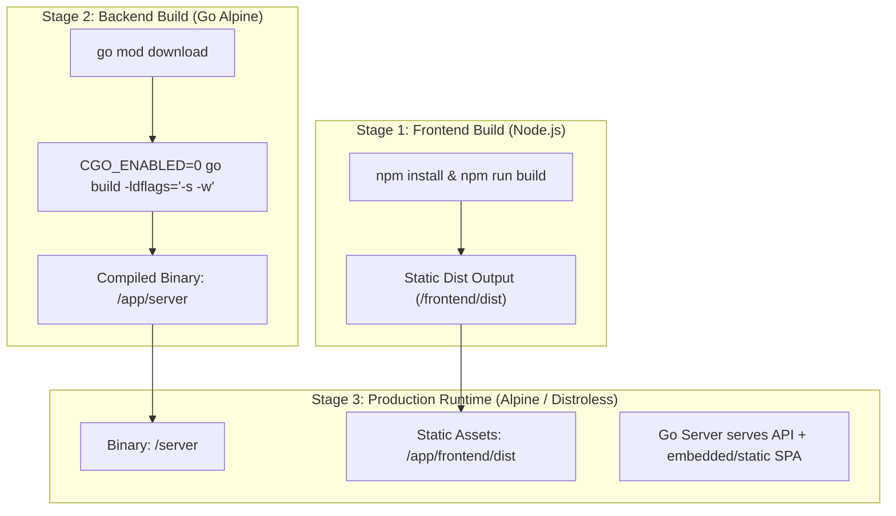

# Implementation Plan: Full-Stack Calculator App (Go Gin + React SPA)

## 1. Executive Summary & Architecture Overview

The system is a full-stack calculator application designed to evaluate multi-operand, multi-operator mathematical expressions. The user interacts with a responsive React Single Page Application (SPA), while expression parsing, tokenization, validation, and mathematical computation are handled server-side by a Go service built with the Gin framework.



---

## 2. Mathematical Engine & Grammar Specification

The calculator accepts complex expression strings containing multiple operands and operators with standard precedence and parentheses grouping:

### Supported Operations
| Operation | Operator Syntax | Associativity | Precedence | Example | Notes |
| :--- | :--- | :--- | :--- | :--- | :--- |
| **Parentheses** | `(`, `)` | N/A | Highest (0) | `(2 + 3) * 4` | Sub-expression isolation |
| **Square Root** | `sqrt(x)` or `√(x)` | Right / Prefix | 4 | `sqrt(16) + 2` | Domain: $x \ge 0$ |
| **Percentage** | `%` | Postfix unary | 4 | `50 * 20%` | Converts $x$ to $x / 100$ |
| **Exponentiation**| `^` | Right | 3 | `2 ^ 3 ^ 2` | Evaluated as $2^{(3^2)} = 512$ |
| **Unary Negation**| `-` | Right / Prefix | 3 | `-5 + 3`, `4 * -2` | Differentiated from binary subtraction |
| **Multiplication**| `*` or `×` | Left | 2 | `6 * 7` | Binary operation |
| **Division** | `/` or `÷` | Left | 2 | `20 / 4` | Checked for division by zero ($|x| < 10^{-12}$) |
| **Addition** | `+` | Left | 1 | `12 + 34` | Binary operation |
| **Subtraction** | `-` | Left | 1 | `45 - 12` | Binary operation |

### Lexing & Parsing Approach
- **Lexer/Tokenizer**: Scans characters into discrete tokens (`TOKEN_NUMBER`, `TOKEN_OPERATOR`, `TOKEN_FUNCTION`, `TOKEN_LPAREN`, `TOKEN_RPAREN`). Handles scientific notations, decimals, whitespace stripping, and distinguishes unary minus from binary minus based on preceding token context.
- **Parser (Dijkstra's Shunting-Yard Algorithm)**: Converts infix token stream into Reverse Polish Notation (RPN) queue:
  - Handles operator precedence and right-associativity of `^`.
  - Validates bracket matching and reports position of unmatched parenthesis.
- **Evaluator**: Stack-based evaluation of RPN queue using 64-bit IEEE 754 floats (`float64`) with precision formatting to prevent artifacts like `0.1 + 0.2 = 0.30000000000000004`.

---

## 3. Project Structure

```
calculator-app/
├── cmd/
│   └── server/
│       └── main.go                 # Gin server entrypoint & router initialization
├── internal/
│   ├── api/
│   │   ├── handlers/
│   │   │   ├── calculator.go       # POST /api/v1/calculate handler
│   │   │   ├── calculator_test.go  # HTTP handler integration/unit tests
│   │   │   └── health.go           # GET /api/v1/health handler
│   │   ├── middleware/
│   │   │   ├── cors.go             # Cross-Origin Resource Sharing configuration
│   │   │   └── recovery.go         # Panic recovery & error format middleware
│   │   └── routes.go               # Router registry
│   └── calculator/
│       ├── evaluator.go            # RPN evaluation execution engine
│       ├── evaluator_test.go       # Comprehensive math & edge case unit tests
│       ├── lexer.go                # Tokenizer (numbers, operators, functions)
│       ├── lexer_test.go           # Tokenizer unit tests
│       ├── parser.go               # Shunting-yard infix-to-RPN parser
│       └── types.go                # Token and AST types
├── frontend/
│   ├── public/
│   │   └── favicon.svg
│   ├── src/
│   │   ├── components/
│   │   │   ├── Calculator.tsx      # Main calculator wrapper
│   │   │   ├── Display.tsx         # Expression bar & result display
│   │   │   ├── Keypad.tsx          # Responsive button grid with symbols
│   │   │   ├── HistoryLog.tsx      # In-memory history drawer/panel with reuse actions
│   │   │   └── ErrorAlert.tsx      # Dismissible error banner
│   │   ├── hooks/
│   │   │   └── useCalculator.ts    # Calculator state, keyboard listener, API integration
│   │   ├── services/
│   │   │   └── api.ts              # Backend API client
│   │   ├── types/
│   │   │   └── calculator.ts       # Shared TypeScript types
│   │   ├── utils/
│   │   │   ├── validation.ts       # Client-side syntax validation
│   │   │   └── formatting.ts       # Pretty-printing numbers & expressions
│   │   ├── App.tsx
│   │   ├── main.tsx
│   │   └── index.css               # Tailwind CSS styles
│   ├── tests/
│   │   ├── Calculator.test.tsx     # UI integration tests
│   │   └── validation.test.ts      # Client validation unit tests
│   ├── package.json
│   ├── tsconfig.json
│   ├── tailwind.config.js
│   └── vite.config.ts
├── Dockerfile                      # Full-stack multi-stage production Dockerfile
├── docker-compose.yml              # Local containerized orchestration
├── go.mod
├── go.sum
└── README.md                       # Documentation, architecture, setup & API guide
```

---

## 4. API Contract & Schema

### `POST /api/v1/calculate`
Evaluates a mathematical expression string.

#### Request Body
```json
{
  "expression": "10 + 5 * 2^3 - sqrt(64) + 20%"
}
```

#### Success Response (`200 OK`)
```json
{
  "success": true,
  "expression": "10 + 5 * 2^3 - sqrt(64) + 20%",
  "result": 42.2,
  "formatted": "42.2",
  "execution_time_ms": 0.08
}
```

#### Error Response (`400 Bad Request` or `422 Unprocessable Entity`)
```json
{
  "success": false,
  "error": "Division by zero is undefined",
  "code": "MATH_DOMAIN_ERROR",
  "position": 14
}
```

### `GET /api/v1/health`
Health check endpoint for Docker / orchestration.
```json
{
  "status": "healthy",
  "timestamp": "2026-11-04T08:02:30Z"
}
```

---

## 5. Frontend UI/UX Design & Capabilities

1. **Dual Input Mode**:
   - **Interactive Keypad**: Visual buttons with tactile feedback, operator categorization (scientific/functions, core operators, digits, actions).
   - **Direct Text Input & Physical Keyboard**: Full keyboard bindings (digits, `+`, `-`, `*`, `/`, `^`, `%`, `Enter` for calculation, `Backspace` for delete, `Escape` for Clear).
2. **Display Panel**:
   - Top line: Active expression scrollable container with syntax highlighting or clear cursor positioning.
   - Bottom line: Live preview / calculated result with loading spinner while API request is in-flight.
3. **In-Memory History Log**:
   - Persists list of completed calculations (`{ id, expression, result, timestamp }`) in application memory.
   - **Interactive Recall**: Clicking a history item allows copying the expression back to the display or inserting the result as the next operand.
   - Clear history button.
4. **Responsive Layout**:
   - **Mobile (< 640px)**: Compact vertical keypad layout; History accessible via slide-over drawer / bottom sheet.
   - **Tablet / Desktop (>= 640px)**: Side-by-side split layout: Calculator grid on the left, permanent history panel on the right.
5. **Robust Error Handling**:
   - Client-side pre-validation: prevents double decimal dots (`12.3.4`), consecutive binary operators (`5 + * 2`), and alerts unmatched brackets before sending.
   - Server error reflection: clearly informs user of domain issues (e.g., negative square roots: `sqrt(-9)`, division by zero).

---

## 6. Full-Stack Docker Deployment Strategy

A production-ready multi-stage `Dockerfile` combines the frontend build with the Go binary into a single, self-contained, lightweight container (< 25MB):



The Go Gin server embeds or statically serves the compiled React assets when running in production mode, routing non-API paths to `index.html` for client-side routing.

---

## 7. Testing Strategy

### Backend Tests (`go test ./... -v -cover`)
1. **Lexer Tests**:
   - Positive tokenization: integers, floats, operators, parentheses, functions (`sqrt`), percentages.
   - Unary minus differentiation: `-5`, `3 - -2`, `( -4 + 1 )`.
   - Malformed tokens / unknown characters.
2. **Parser & Evaluator Tests**:
   - Operator precedence: `2 + 3 * 4` = `14` (not `20`).
   - Exponentiation associativity: `2 ^ 3 ^ 2` = `512`.
   - Square root evaluation: `sqrt(144) + 1` = `13`.
   - Percentage evaluation: `100 * 15%` = `15`, `50 + 10%` = `50.1`.
   - Complex nested expressions: `(5 + 3) * 2^2 - sqrt(25) + 50%` = `27.5`.
   - Edge cases: Division by zero (`5 / 0`), negative square root (`sqrt(-4)`), mismatched parentheses (`(2 + 3`), empty string, expression with only whitespace.
3. **HTTP Handler Integration Tests**:
   - Request serialization, HTTP 200 with JSON payload, HTTP 400 on invalid expression, HTTP 422 on math domain error.

### Frontend Tests (`npm run test`)
1. **Component Tests (Vitest + React Testing Library)**:
   - Keypad button click appends characters to expression.
   - Calculation submits expression and displays result.
   - History item is appended upon successful calculation.
   - History click restores expression or result.
   - Error banner appears when backend returns an error.
   - Keyboard events trigger corresponding inputs.

---

## 8. Implementation Steps

1. **Step 1: Backend Foundation & Calculator Engine**
   - Initialize Go module (`go mod init github.com/suryakantbansal/calculator-app`).
   - Implement `lexer.go`, `parser.go`, and `evaluator.go` with full support for `+`, `-`, `*`, `/`, `^`, `sqrt`, `%`, unary minus, and parentheses.
   - Write comprehensive unit tests in `evaluator_test.go` and `lexer_test.go`.
2. **Step 2: Backend API & Server Setup**
   - Install Gin framework (`github.com/gin-gonic/gin`).
   - Implement HTTP handlers, input validation, CORS middleware, and routes.
   - Write integration tests in `calculator_test.go`.
3. **Step 3: Frontend Setup & Core UI Components**
   - Initialize React SPA with Vite, TypeScript, and Tailwind CSS in `/frontend`.
   - Implement `Display`, `Keypad`, `HistoryLog`, and `ErrorAlert` components.
   - Implement `useCalculator` hook with keyboard support and history management.
4. **Step 4: API Integration & Client Validation**
   - Connect frontend API service to backend `/api/v1/calculate`.
   - Add responsive styles for mobile, tablet, and desktop viewports.
   - Write frontend unit tests with Vitest and React Testing Library.
5. **Step 5: Full-Stack Dockerization & Static Asset Serving**
   - Configure Gin to serve static frontend assets in production mode.
   - Author multi-stage `Dockerfile` and `docker-compose.yml`.
   - Verify local container build and execution.
6. **Step 6: Documentation & Verification**
   - Create comprehensive `README.md` with architectural design rationale, API examples with `curl`, local setup commands, and Docker instructions.
   - Run full test suites across Go and React.
